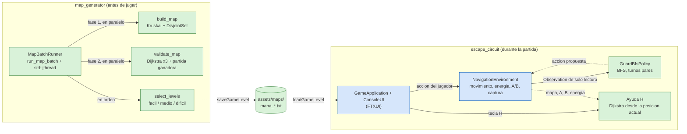

# Arquitectura de la aplicación

Diagrama editable (Mermaid). Se ve en GitHub y en CLion (plugin Mermaid). Azul: componentes reutilizados del Proyecto 1;
verde: componentes nuevos.

Flujo de un turno: acción del jugador → comprobar captura → vigilante (BFS, solo turnos pares) → comprobar resultado
(captura o energía agotada = derrota; si no, activar interruptor y comprobar escape).
